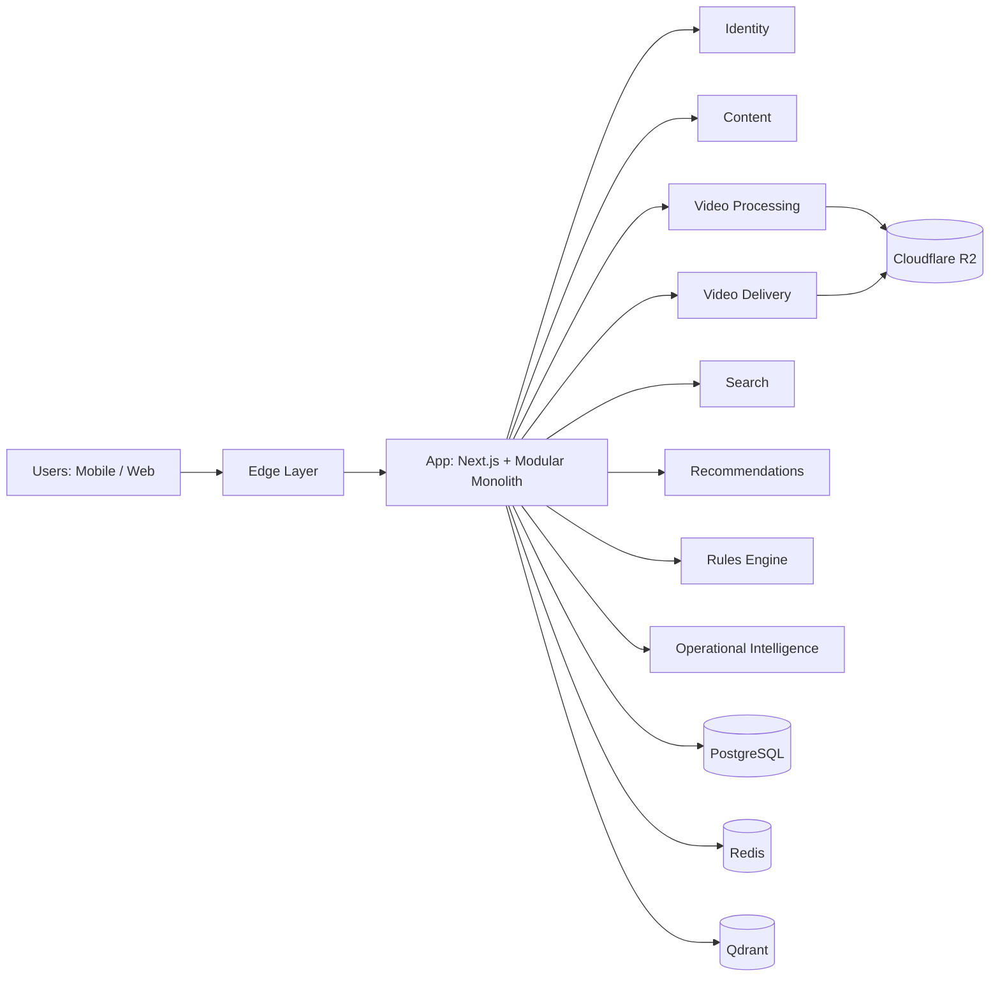
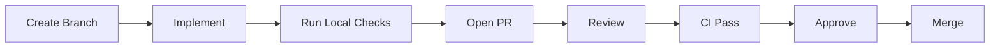
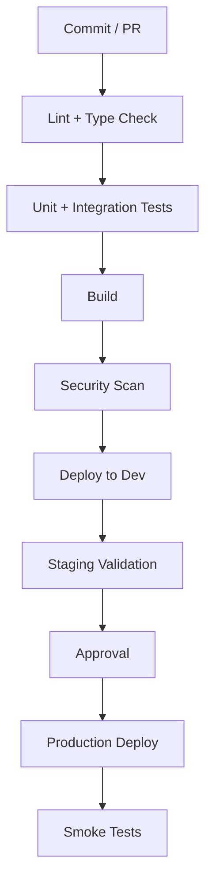
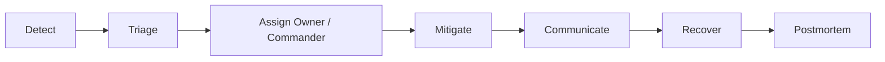

# ENGINEERING_HANDBOOK.md

Version: `1.0`  
Project: `Journal Club Asia` powered by the `Okkhor` platform  
Status: `Active`  
Owner: `Engineering Lead`  
Review Cycle: `Quarterly`  
Last Updated: `2026-07-18`

## 1. Purpose

This handbook defines the engineering operating model for `Journal Club Asia / Okkhor`.

It standardizes:

- technical workflows
- development practices
- code quality expectations
- security and compliance rules
- release and incident procedures
- collaboration norms
- maintenance and technical debt handling

This document is the default source of truth for engineering process until superseded by an approved ADR, runbook, or updated handbook version.

## 2. Project Overview

### 2.1 Mission

`Okkhor` is a multilingual, AI-powered knowledge platform that makes global research, innovation, and best practices accessible in the learner's native language.

### 2.2 Product Principles

- `Performance is accessibility`
- `Predict before react`
- `Cache before compute`
- `Gracefully degrade instead of fail`
- `Comprehension, not just translation`
- `Build for South Asian infrastructure reality, not Western assumptions`

### 2.3 User and Market Reality

The platform is designed for:

- mobile-first usage
- low-end Android devices with `2-4 GB RAM`
- unstable and high-latency 3G/4G paths
- shared-device household behavior
- Bangla-first and multilingual UX needs
- data-sensitive users across South Asia

### 2.4 High-Level System Intent

The current engineering direction is:

- `Modular Monolith` first
- `Next.js App Router + TypeScript` for the main product surface
- `PostgreSQL` as primary source of truth
- `Redis` for cache and ephemeral state
- `Qdrant` for semantic discovery and recommendations
- `Cloudflare R2 + CDN + Workers` for asset delivery and edge logic
- `FFmpeg` for media processing
- `Protocol Buffers` for high-frequency, mobile-sensitive APIs where justified

## 3. Technical Architecture and System Context

### 3.1 Architecture Style

The platform starts as a `modular monolith` because it provides:

- high development velocity
- low operational overhead
- simpler debugging and testing
- in-process communication
- strong internal boundaries without early distributed-system complexity

Microservices are not the default. Service extraction happens only when domain complexity, scale, or team ownership makes unified deployment risky.

### 3.2 Core Domains

The expected module boundaries are:

- `Identity`
- `Content`
- `Video Processing`
- `Video Delivery`
- `Search`
- `Recommendations`
- `Rules Engine`
- `Localization`
- `Analytics`
- `Operational Intelligence`

### 3.3 System Context Diagram



### 3.4 Architecture Documentation Requirements

Every significant technical area must eventually have:

- a module README
- API contract notes
- data model summary
- failure and fallback notes
- runbooks for operationally sensitive components
- ADRs for major decisions

Recommended repository layout once scaffolding begins:

```text
/docs
  /architecture
  /adr
  /runbooks
  /standards
/src
  /modules
  /shared
/tests
  /unit
  /integration
  /e2e
  /performance
/scripts
/infrastructure
```

## 4. Development Environment Setup

### 4.1 Baseline Requirements

All contributors must use consistent local tooling.

Recommended baseline:

- `Node.js` LTS
- `pnpm` or `npm` pinned in project metadata
- `PostgreSQL`
- `Redis`
- optional local `Qdrant`
- `FFmpeg` available on PATH
- Docker Desktop or equivalent container runtime

### 4.2 Local Setup Rules

Until repo scripts exist, the setup policy is:

- copy `.env.example` to `.env.local`
- never commit `.env.local`
- install dependencies with the project-standard package manager only
- run database migrations before app startup
- use seed scripts for local data, never hand-edit local DB state as a substitute for migrations

### 4.3 Dependency Management Rules

- Prefer built-in platform capabilities and existing internal utilities before adding new dependencies.
- New runtime dependencies require justification in the PR description.
- Remove unused packages in the same change that removes their usage.
- Pin critical infrastructure SDKs and serialization libraries to tested versions.
- Every new environment variable must be documented in `.env.example` and `docs/configuration.md`.

## 5. Code Standards and Style Guides

### 5.1 General Standards

- Optimize for readability first.
- Prefer simple solutions over clever abstractions.
- Keep domain logic isolated from framework code.
- Avoid hidden coupling between modules.
- Fail explicitly; never silently swallow errors.

### 5.2 Naming

- `camelCase` for variables and functions
- `PascalCase` for React components, types, and classes
- `kebab-case` for file names unless framework convention requires another pattern

### 5.3 TypeScript Standards

- TypeScript is the default for application code.
- Avoid `any` except where unavoidable and documented.
- Export shared types from stable module interfaces, not from deep internal files.
- Validate external input at runtime even when compile-time types exist.
- Keep DTOs, domain models, and persistence models intentionally separated where needed.

### 5.4 React and Next.js Standards

- Prefer server components by default.
- Use client components only when interactivity or browser APIs require them.
- Keep client bundles small.
- Use route-level loading and error boundaries.
- Separate presentational components from business logic and data orchestration.
- Lazy-load non-critical UI modules.

### 5.5 Data Layer Standards

- `PostgreSQL` is the primary source of truth.
- No manual production schema changes outside migrations.
- `Redis` is never the source of truth for critical data.
- `Qdrant` must always have a fallback path when vector lookup fails.
- Indexes require query-level justification.

### 5.6 Performance Rules

- Performance is a product requirement.
- Keep critical mobile payloads lean.
- Prefer protobuf over JSON for high-frequency, mobile-sensitive paths where there is measurable benefit.
- Reduce rerenders and memory churn.
- Avoid heavy scripts in the initial render path.
- Optimize for low-end Android first.

## 6. Version Control Workflow

### 6.1 Branch Naming

Use the following patterns:

- `feature/<scope>-<short-description>`
- `fix/<scope>-<short-description>`
- `chore/<scope>-<short-description>`
- `docs/<scope>-<short-description>`
- `hotfix/<scope>-<short-description>`

Examples:

- `feature/auth-phone-otp`
- `fix/playback-stall-retry`
- `docs/add-engineering-handbook`

### 6.2 Commit Message Standard

Use Conventional Commits:

- `feat: add Bangla onboarding flow`
- `fix: prevent stale session refresh loop`
- `docs: add engineering handbook`
- `refactor: isolate recommendation cache keys`
- `test: add regression coverage for playback fallback`

### 6.3 Pull Request Rules

Every PR must include:

- a clear summary
- linked ticket or work item
- testing evidence
- risk assessment
- rollback note for risky changes
- screenshots or recordings for UI changes

### 6.4 Review Requirements

- No direct pushes to `main`
- Minimum `1` approval for standard PRs
- Minimum `2` approvals for auth, payments, infra, security, or architecture changes
- All required CI checks must pass before merge
- Squash merge by default

### 6.5 Merge Flow



## 7. Agile Delivery Model

### 7.1 Working Style

The team follows a pragmatic agile model:

- small vertical slices
- frequent integration
- short feedback loops
- progressive hardening
- documentation updated with delivery, not months later

### 7.2 Definition of Ready

Work should not enter active development unless it has:

- clear business outcome
- acceptance criteria
- dependencies identified
- risk level understood
- design/architecture note if complexity is medium or high

### 7.3 Definition of Done

Work is done only when:

- code is merged
- tests are updated
- required docs are updated
- observability is adequate
- rollout and rollback are understood
- no critical open review concerns remain

### 7.4 Sprint and Release Rhythm

Recommended cadence:

- daily async standup or short sync
- weekly planning / prioritization
- biweekly review and retrospective
- continuous delivery to dev/staging
- approval-gated releases to production

## 8. CI/CD, Testing, and Deployment

### 8.1 CI Minimum Standard

Every change must pass:

- install
- lint
- type-check
- unit tests
- integration tests for affected areas
- build verification
- dependency/security scan

### 8.2 Testing Requirements

#### Unit Tests

Required for:

- pure business logic
- rules evaluation
- parsers and serializers
- utility functions
- complex hooks

#### Integration Tests

Required for:

- API handlers
- DB interactions
- cache behavior
- auth/session flows
- queue-backed workflows

#### End-to-End Tests

Required for critical user journeys:

- login / OTP
- onboarding
- playback start
- progress persistence
- Bangla locale switching
- subscription flow if applicable

#### Performance Tests

Required before releasing changes that affect:

- payload structure
- playback startup
- caching
- recommendation/feed generation
- auth/session handling

### 8.3 Deployment Procedures

#### Development

- auto-deploy allowed
- mocks and sandboxes acceptable

#### Staging

- production-like config required
- mandatory QA and smoke validation

#### Production

- approval-gated deploys
- release notes required
- rollback path required
- post-deploy smoke tests mandatory

### 8.4 CI/CD Flow



## 9. Security Protocols, Data Handling, and Compliance

### 9.1 Security Rules

- Validate all external inputs.
- Enforce authorization on the server, never only in the UI.
- Rotate and revoke sessions safely.
- Keep secrets in approved secret stores only.
- Never log credentials, OTPs, tokens, or sensitive personal data.

### 9.2 Shared Device Protection

Because shared-device use is common in South Asia, product and engineering must support:

- quick logout
- optional PIN re-entry for sensitive flows
- device-aware session handling
- clear active-user state transitions

### 9.3 Data Handling

Classify data as:

- `Public`
- `Internal`
- `Sensitive`
- `Restricted`

Rules:

- collect minimum necessary data
- define retention per class
- purge unnecessary data on schedule
- document third-party processors and external data flows

### 9.4 Compliance

The project must remain ready for:

- privacy requirements
- regional payment and tax compliance
- Bangla language and Bangladesh locale support
- configurable rules updates without hard-coded logic changes

## 10. Incident Response, Bug Reporting, and Troubleshooting

### 10.1 Incident Severity

- `SEV-1`: platform unavailable, major security issue, or core business outage
- `SEV-2`: major degradation with significant user impact
- `SEV-3`: limited degradation with workaround
- `SEV-4`: minor issue

### 10.2 Incident Workflow



### 10.3 Incident Rules

Every serious incident requires:

- timeline
- impact summary
- root cause
- remediation items
- owner for each follow-up action

### 10.4 Bug Reporting Workflow

A valid bug report must include:

- expected behavior
- actual behavior
- environment
- repro steps
- severity
- logs or screenshots if safe

### 10.5 Troubleshooting Framework

Use the following order:

1. Confirm scope and impact
2. Check recent deployments
3. Inspect logs, metrics, and traces
4. Validate dependency health
5. Attempt reproduction
6. Apply mitigation
7. Record findings

## 11. Team Collaboration Norms

### 11.1 Communication Channels

Maintain distinct channels for:

- engineering discussion
- incidents
- release coordination
- architecture/ADR decisions
- product-engineering sync

### 11.2 Working Norms

- Default to async for non-urgent decisions.
- Write down important decisions.
- Escalate blockers early.
- Keep discussions discoverable and linked to work items.
- Do not leave architectural decisions buried only in chat.

### 11.3 Meeting Cadence

- daily async standup or 15-minute sync
- weekly planning
- biweekly architecture review
- monthly reliability / incident review
- quarterly handbook review

## 12. Maintenance, Technical Debt, and Legacy Sunsetting

### 12.1 Maintenance Schedule

- weekly dependency and health review
- monthly infra and cost review
- quarterly architecture and handbook review

### 12.2 Technical Debt Policy

- Reserve capacity in each sprint for debt reduction.
- Log high-risk debt with owner, impact, and target resolution date.
- Prioritize debt that affects performance, security, or delivery velocity.

### 12.3 Legacy Sunsetting Procedure

Before deprecating old systems or patterns:

1. Define replacement path
2. Publish deprecation notice
3. Set freeze date
4. Migrate traffic or data
5. Remove obsolete implementation
6. Archive docs and record ADR/update note

## 13. Operational Readiness and Regional Resilience

### 13.1 Predictive Operations Rule

The platform follows `predict before react`.

Known regional spikes such as:

- Eid-ul-Fitr
- Eid-ul-Adha
- Friday traffic shifts
- exam season
- viral content events

must trigger readiness review before peak demand.

### 13.2 24-Hour Readiness Rule

For expected high-traffic events:

- begin readiness checks at least 24 hours early
- warm caches and critical manifests
- validate queue depth and cache hit targets
- reduce risky background jobs if needed

### 13.3 Graceful Degradation Policy

Under stress:

- preserve auth, playback, progress, and subscription-critical paths first
- shed non-essential writes
- fall back to trending/editorial content if recommendations degrade
- prefer degraded continuity over hard failure

## 14. Success Metrics for Handbook Adoption

The handbook is only useful if it is followed. Track:

### 14.1 Workflow Adoption

- `%` of PRs using required template
- `%` of merges meeting review policy
- `%` of new env vars documented

### 14.2 Quality Metrics

- CI pass rate
- escaped defect rate
- regression rate
- production incident frequency

### 14.3 Operational Metrics

- MTTD
- MTTR
- number of incidents with usable runbooks
- number of incidents caused by undocumented process gaps

### 14.4 Documentation Health

- quarterly review completed on time
- architecture docs updated within one sprint of major changes
- ADR backlog maintained below agreed threshold

## 15. Handbook Governance and Version Control

### 15.1 Versioning

Use `major.minor`:

- `major`: structural or policy-breaking changes
- `minor`: clarifications and non-breaking updates

### 15.2 Update Process

All handbook changes must:

- be proposed by PR
- use label `docs-handbook`
- include reason for change
- include affected sections
- be approved by Engineering Lead plus one relevant owner

### 15.3 Quarterly Review Cycle

At the start of each quarter:

- assign review owners
- review architecture, security, testing, incident, and collaboration sections
- remove obsolete rules
- publish updated version and summary of changes

### 15.4 Change Log Template

```text
Version:
Date:
Owner:
Sections Updated:
Reason for Change:
Approvers:
Rollout / Communication Plan:
```

## 16. Initial ADR Backlog

The project should create these ADRs early:

- `ADR-001`: Adopt Modular Monolith
- `ADR-002`: Adopt Next.js App Router
- `ADR-003`: Adopt Cloudflare R2 for assets
- `ADR-004`: Adopt PostgreSQL as primary source of truth
- `ADR-005`: Adopt Redis for cache and ephemeral state
- `ADR-006`: Adopt Qdrant for semantic discovery
- `ADR-007`: Adopt offline-first support where client context requires it
- `ADR-008`: Adopt calendar-aware predictive operations

## 17. Immediate Bootstrap Actions

Since this repository is currently empty, the engineering team should execute the following in the next setup sprint:

1. Scaffold the repository structure
2. Add `.editorconfig`, linting, formatter, and TypeScript config
3. Add PR template, issue template, and ADR template
4. Add `docs/architecture`, `docs/adr`, and `docs/runbooks`
5. Add environment example file and configuration doc
6. Add CI workflow for lint, type-check, test, and build
7. Add initial ADR set listed above

## 18. Final Principle

This handbook is not static documentation.  
It is an engineering contract for how the team builds, reviews, ships, secures, and evolves `Journal Club Asia / Okkhor`.
